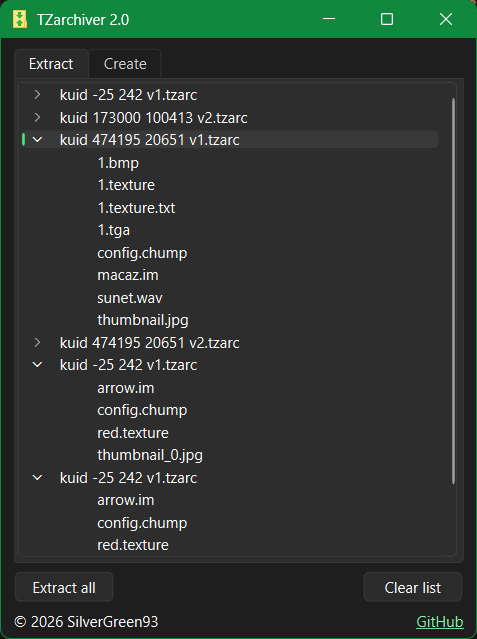

# TZarchiver

Utility application to read and write Trainz `.tzarc` files.



**Note** that Trainz 2022 changed the TZarc format to v2, with zlib
compression. Both reading and writing v2 archives are supported here: from the
command line with `--v2`, or in the GUI with the "Create compressed v2
archives" checkbox.

## Getting Started

From a terminal:

```
pip install -e ".[gui]"
tzarchiver-gui                 # open the GUI
tzarchiver "Some Asset.tzarc"  # list an archive
```

Or run straight from the source tree — `tzarchiver_cli_entry.py` /
`tzarchiver_gui_entry.py` add `src/` to the path themselves, so no install
and no `PYTHONPATH` are needed (the GUI still needs PyQt6 in the interpreter
you use, e.g. `python -m venv .venv` + `pip install -e ".[gui]"`).

## Command line

```
tzarchiver <file or folder>...            list archives / archive folders
tzarchiver -x <file.tzarc> [-o <out>]     extract (default: <archive name> beside the archive)
tzarchiver <folder> [--v2]                create <folder>.tzarc (--v2 = compressed)
```

With no arguments the GUI starts instead; paths given on the command line are
queued in the window, exactly like drag & drop.

## Project layout

```
src/tzarchiver/tzarc.py   archive format logic (v1 + v2), no Qt imports
src/tzarchiver/cli.py     command line entry point
src/tzarchiver/gui.py     PyQt6 window (port of frmMain)
tests/                    pytest suite, fixtures in tests/test_files
```

Run the tests with `python -m pytest` (no installation needed, `tests/conftest.py`
puts `src` on the path).

## Packaging

`build.py` builds distributable packages for the host OS:

| Platform | Artifact | Requirement |
|----------|----------|-------------|
| Windows  | `dist/TZarchiver.exe` (GUI) and `dist/TZarchiverCli.exe` (CLI), both one-file | `pip install ".[gui,build]"` |
| Windows  | `dist/TZarchiver-<ver>.msi` — per-user installer (no elevation) | `pwsh installer/build.ps1` (needs [WiX v5](https://wixtoolset.org/)) |
| macOS    | `dist/TZarchiver-<ver>-macos.dmg` | `pip install ".[gui,build]"` |
| Linux    | `dist/tzarchiver_<ver>_amd64.deb` and `.pkg.tar.zst` | `gem install fpm` |

```
python build.py                 # build everything this host supports
python build.py --only exe      # build a single artifact
pwsh installer/build.ps1        # MSI, after the exes exist
```

The MSI installs both exes into `%LOCALAPPDATA%\Programs\TZarchiver`, adds
Start Menu shortcuts, puts `tzarchivercli` on the user PATH, and registers a
normal Add/Remove Programs entry — all per-user, so it never asks for
administrator rights.

PyInstaller cannot cross-compile, so each artifact must be built on its target
OS; remember to bump `VERSION` in `build.py` together with the version in
`pyproject.toml`.

## File Format Specifications

The TZarc File Format Specification was determined by reverse-engineering and
is described here: [TZarc File Format Specification](tzarc-format.md)

## Issues and Feature requests

For any bugs, issues or feature requests, use the Issues tab in GitHub.

## License

This project is licensed under the MIT License - see [LICENSE.md](LICENSE.md) file for details.

## Acknowledgments

This project was possible by doing reverse engineering on the TZarc file format and no official information was given in regards to this file format from Auran/N3V.

## Related Trainz tools

- [CDP Explorer](https://github.com/SilverGreen93/CDPExplorer)
- [Kuid Lister](https://github.com/SilverGreen93/KuidLister)
- [Kuid2Hash](https://github.com/SilverGreen93/Kuid2Hash)
